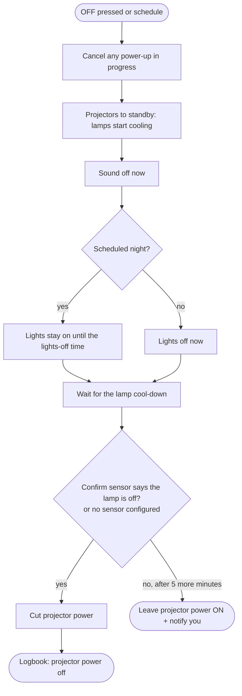

# show-power

[](https://github.com/joe-pero/show-power/actions/workflows/tests.yml)

**Safe, checked, weather-aware power for outdoor displays in Home Assistant.**

Halloween yards and Christmas light shows usually run on smart plugs and a couple of timers.
That works until a plug misses its command and half the yard stays dark, a projector lamp gets
its power cut while it's hot, the speakers are still going at bedtime, or the whole show runs
in the rain.

`show-power` turns a short description of your yard into a ready-made Home Assistant package
that handles all of that. You describe your switches once; it writes the scripts, automations
and helpers.

## What you get

- **One button.** `switch.<name>_power`: ON is a checked power-up, OFF is a safe shutdown.
- **Checked power-up.** Switches come on one at a time (spreading the inrush current), and each
  one has to *report* that it's on. If it doesn't, the command is re-sent, and if it still isn't on
  you get a notification naming exactly which switch.
- **Projectors are never hard-cut.** At shutdown the lamps go to standby first, cool down, and
  only then lose power. If you have a sensor that can confirm a lamp is off, the power is cut
  only when it agrees; otherwise the circuit is left ON and you're told why.
- **Sound off at bedtime, lights later.** Anything that makes noise goes off at show end;
  lights can stay on until a later time.
- **Rain skip.** Before powering up, it reads your weather forecast. If the chance of rain in
  the next few hours is over your limit, it skips the night and tells you. One toggle runs the
  show anyway. If the forecast can't be read, the show runs and you're told that too.
- **Skip dates and hands-off nights.** A box for nights to leave alone, and dates (like
  Halloween) when the schedule never turns the show off, so you can.
- **Delayed and chained power.** A prop that must come up last, or a smart plug that's powered
  *by* another switch (it waits for it to boot before turning it on, and never switches it off
  directly).
- **Nothing fails silently.** Every check that fails sends a notification and writes to the logbook.

## How it works

**Power-up** (the ON button, or the schedule at sunset):

```mermaid
flowchart TD
    A([ON pressed or sunset]) --> R{Rain check<br/>chance of rain over your limit?}
    R -- "yes, and 'ignore rain' is off" --> S([Skip tonight + notify you])
    R -- "no, or forecast unreadable (you're told)" --> C[Cancel any shutdown in progress]
    C --> N[Next switch, projectors first]
    N --> T[Turn it on, wait up to 10 s for it to report ON]
    T --> V{Reported ON?}
    V -- no --> RT{Tried 3 times?}
    RT -- no --> T
    RT -- yes --> L[Move on (each retry is logged)]
    V -- yes --> G[Short gap to spread the inrush current]
    L --> G
    G --> M{More switches?}
    M -- yes --> N
    M -- no --> F{Any switch still not ON?}
    F -- yes --> X([Notify: names the switches that failed])
    F -- no --> OK([Logbook: all on])
```

Delayed props come last, and a smart plug powered *by* another switch is waited for until it's
online before it's turned on. (The rain check runs on the scheduled power-up only; the button always works.)

**Safe shutdown** (the OFF button, or the schedule):



## Quick start

```bash
pip install "git+https://github.com/joe-pero/show-power@v1.0.0"

cp examples/config.example.yaml my_yard.yaml     # change the entity ids to your own
showpower check my_yard.yaml                     # validates and prints the plan
showpower build my_yard.yaml -o yard_show_power.yaml
```

Copy the output into `<config>/packages/` and make sure `configuration.yaml` has:

```yaml
homeassistant:
  packages: !include_dir_named packages
```

Then check the configuration (Developer tools → YAML → Check configuration) and restart.

`showpower check` prints the plan in plain words before anything is written:

```
Yard Show: 6 switches, season 10-01 to 10-31
  ON   sunset-15 unless >= 50% rain in the next 4 h (weather.home)
  OFF  20:30 Sun-Thu, 21:30 Fri-Sat, never on 10-31
  lights stay on until 23:00
  projectors: standby 1 device(s), cool 15 min, cut only when confirmed off
  power-on order:
    projector Porch projectors
    sound     Yard speakers
    sound     Animatronics
    lights    Pathway lights
    other     Back-of-yard extension cord  (+120s delay)
    other     Fog machine (plugged into the extension cord)  (waits 90s to come online, powered via switch.extension_cord_plug)
  button: switch.yard_show_power   skip dates: input_text.yard_show_skip_dates
```

Release notes: [CHANGELOG.md](CHANGELOG.md).

## The config

See [`examples/config.example.yaml`](examples/config.example.yaml); every option is commented.
Each switch gets a **role**:

| Role | At show end |
|---|---|
| `projector` | powered on first (longest warm-up); power cut last, after standby and cool-down |
| `sound` | off first |
| `lights` | off at the `lights_off` time on scheduled nights, or immediately on a manual OFF |
| `other` | off with the sound |

The rain check uses Home Assistant's own `weather.get_forecasts` with any weather integration
that provides an hourly chance of precipitation (for example the US National Weather Service
integration).

## Where this came from

I ran an AI-assisted haunted yard ([harvest-of-shadows](https://github.com/joe-pero/harvest-of-shadows))
for the 2026 season. Every rule in here was learned the hard way that season:

- A smart plug that **boots OFF** whenever the extension cord feeding it powers up kept a whole
  prop dark, hence "wait for it to come online, then turn it on, then check".
- Lamp projectors must cool before power is cut, and an IR blaster can't confirm a projector
  heard it, hence "cut only when confirmed, otherwise leave it on and say so".
- The sound ran too late on a school night, hence sound and lights on separate clocks.
- Rainy nights were skipped by hand from a list of dates. This version reads the forecast.

## Tests

```bash
python3 -m unittest -v
```

The tests check config validation, the order of every power-up and shutdown step, that
projector power is never cut outside the confirm gate, that chained plugs are never switched
off directly, and that skip dates survive a Home Assistant restart. They also **run the
generated templates** (rain chance, skip dates, seasons that cross New Year, "which switches
didn't come on") through a small Home Assistant-style Jinja environment against sample forecasts
and states.

Not yet tested against a running Home Assistant instance; please open an issue if anything in
the generated package doesn't load.

## License

MIT. Built with AI coding assistance (Anthropic Claude), directed by me.
